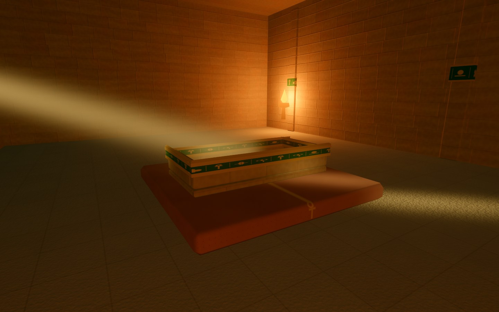
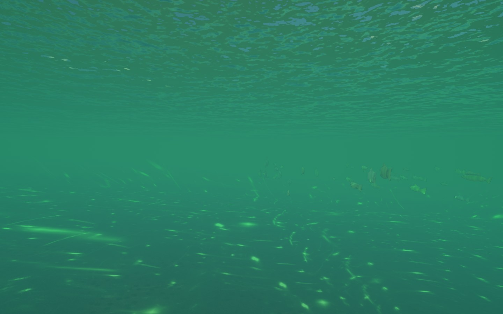
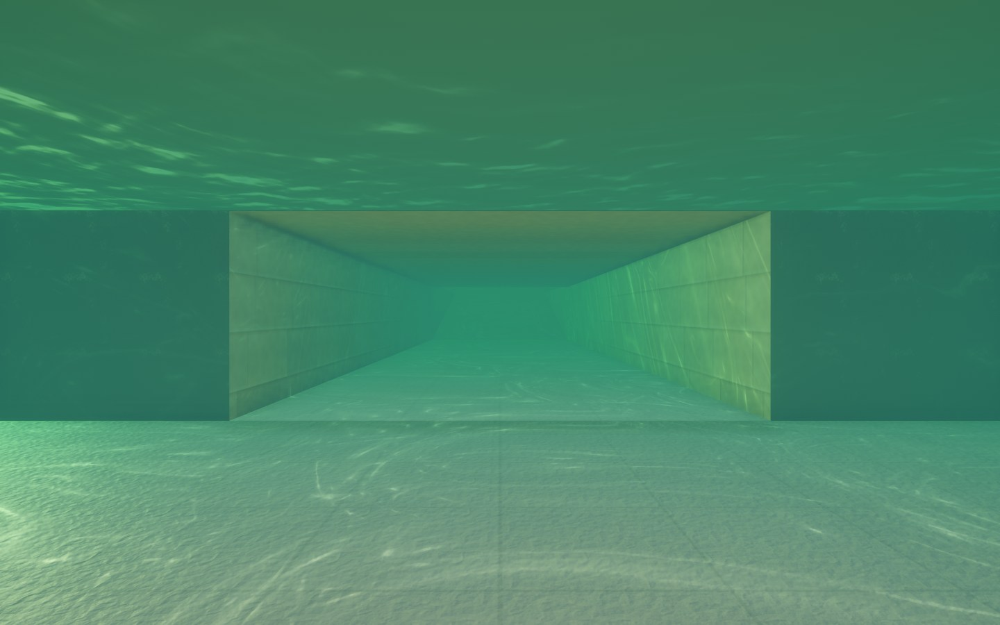
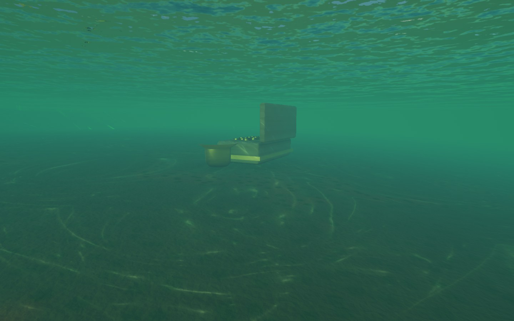
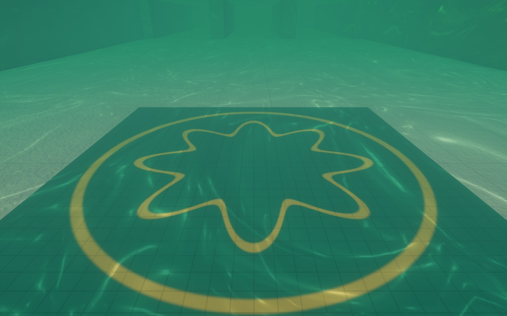

# Passage secret et vie sous-marine — v0.5.0

Captures du navigateur, sans retouche, exportées en JPEG. Rendu WebGPU sur Mac M1 via le navigateur intégré Chromium 157. Les rapports JSON conservent les dimensions et les comptages réels.

## Vérifications

- `check:plan` : 41 607 points terre/eau, 166 surfaces, 53 variantes de maillages ; aller-retour complet canal → galerie → chambre → canal, plafond solide, entrée interdite au-dessus de l’eau, ouverture solaire infranchissable.
- `check:ambiance` : grain 1,25, poissons 1, soleil 12°, niveau sous-marin 3, import/export numérique borné.
- `check:bundle` : HTML autonome pour la scène, JavaScript valide, absence des outils QA, attribution MIT ; seule ressource facultative autorisée : l’icône Apple.
- Captures des trois qualités, sept vues dédiées aux nouveautés et quatre niveaux sous-marins, sans erreur WebGPU signalée.
- Atelier `L` du livrable : grain 1,25 et densité des poissons 1 en tête ; absence de relief renforcé.

## Portée des mesures

En Medium à 1440 × 900, deux relevés de 32 images sur la même vue donnent **12,07 ms GPU sans poissons**, **13,48 ms avec poissons**. Les comptages passent de 68 à 148 instances solides visibles ; `fish-density-0.jpg` et `fish-density-1.jpg` montrent le résultat du curseur. Cette comparaison courte est sensible au bruit, à la chauffe et à l’activité du Mac ; elle ne garantit pas les performances d’un iPhone ni de la future VR.

La chambre ne dessine que trois instances solides visibles et une surface d’eau, contre la cité extérieure beaucoup plus dense. Temps GPU relevé sur cette vue : **6,36 ms**. Les passages d’effets extérieurs sont suspendus, les statistiques restent valides.

Pas de nouveau benchmark continu à 60 i/s, ni de validation d’installation sur un iPhone physique dans cette session. L’adaptation de résolution reste active en visite normale ; ces captures utilisent une résolution demandée fixe, plafonnée par la qualité Low. Le scintillement antérieur de la végétation n’est pas traité ici.

Reproduction : construire `dev.html`, lancer `python3 source/tools/qa-server.py`, ouvrir un seul onglet `dev.html?auto&lv=1&w=1440&h=900&qa=secrets-medium&smoke&secrets`. Les résultats sont dans `/tmp/hapikara-qa/secrets-medium/`. `lv=0` pour High, `lv=2` pour Low. Arrêter le serveur et fermer le test après usage.
