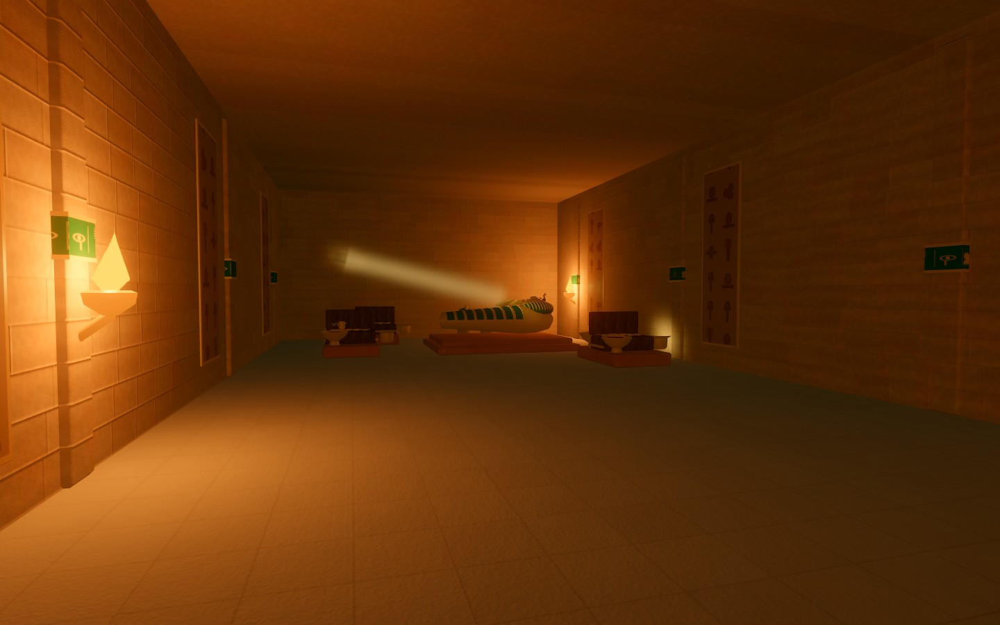
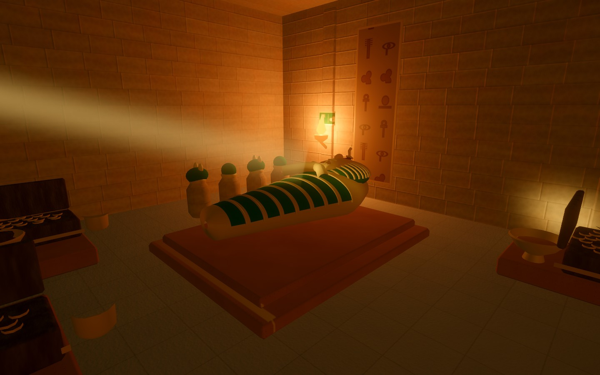
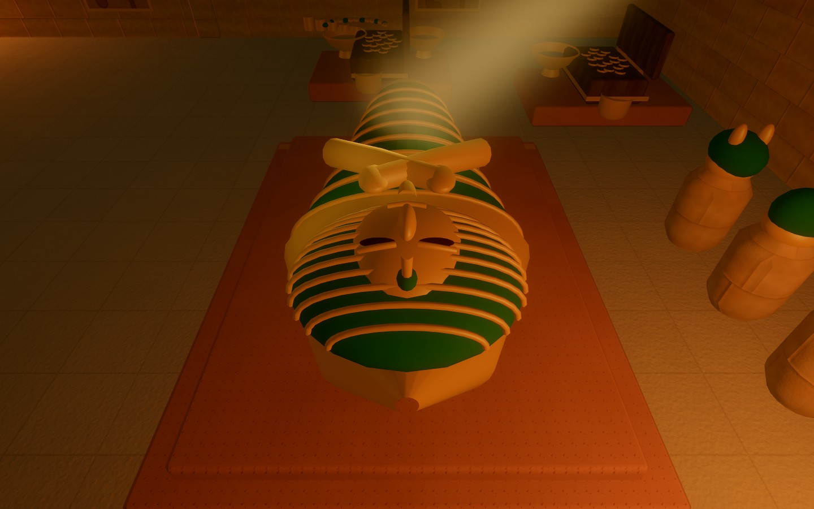
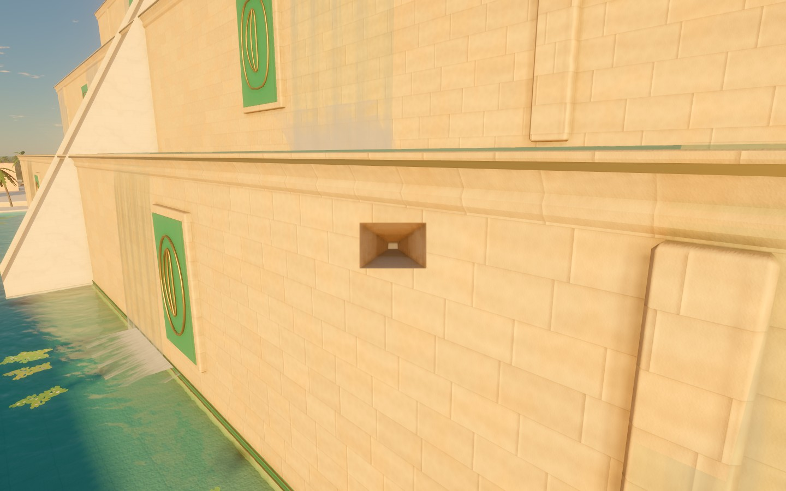
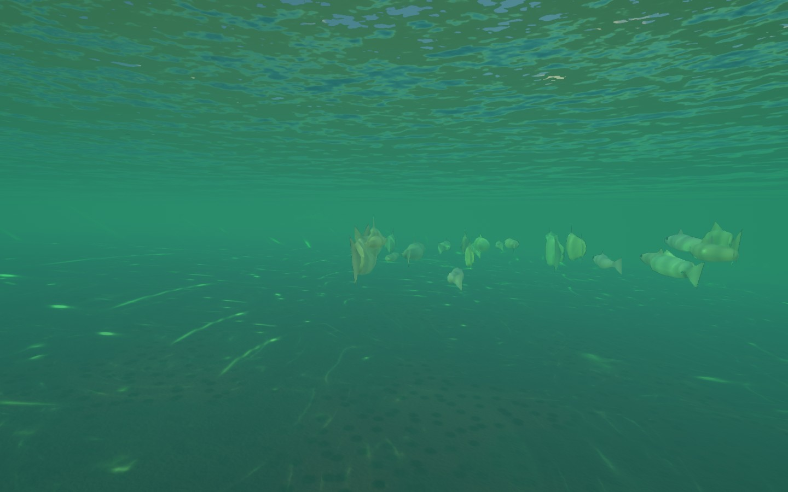

# Plan 1 — v0.6.0

Captures WebGPU du navigateur intégré Chromium 157 sur Mac M1. Export JPEG sans retouche. Référence artistique utilisée : `concept-art/source/crypte-reference-v1.png`, absente du livrable HTML.

## Contrôles automatisés

- `check:plan` : 41 607 points terre/eau, 166 surfaces, 53 variantes de maillages. Aller-retour complet dans la crypte ; les deux parois de la rampe à x=60/70/78/90, les deux parois du virage, plafond et mouvement rapide diagonal restent dans le volume intérieur. La caméra ne traverse pas l’ouverture solaire.
- Contrôle de régression : ces tests exécutés avec `collide.js` de la version précédente échouent à « gallery side wall escape 70,-1 ». Ils passent avec la correction. Le sol/bassin extérieur ne peut plus soulever la caméra à travers la paroi.
- Rayons CPU contre les triangles réels : axe du conduit dégagé dans la pyramide et la chambre, pierre conservée à côté. Vérifications supplémentaires avec soleil à 70°, puis azimuts 90° et 180°. Les triangles sont découpés à la construction, sans opération de soustraction par image.
- Enveloppes de déplacement des poissons vérifiées au-dessus du fond procédural et sous la surface pour les trois populations (320/240/160). Captures Low séparées pour vérifier le rendu au niveau le moins détaillé.
- `check:ambiance`, build et `check:bundle` passent. HTML : 112 253 octets, 95 033 octets gzip ; les ressources 3D restent autonomes.
- Six vues extérieures, quatre niveaux sous-marins et dix vues des nouveautés dans chacune des trois qualités, sans erreur WebGPU remontée. Les JSON conservent les comptages et mesures bruts.

## Mesures et limites

Vue de chambre : 6,55 ms GPU en Medium, 6,62 ms en High à 1440 × 900 ; 2,95 ms en Low à 1214 × 758 (plafond de pixels du niveau). La chambre rend environ 20 000 triangles et la cité extérieure reste exclue. Le ciel procédural est visible au bout du conduit : aucune vue complète de la ville n’est calculée pour cette petite ouverture. Le faisceau et les éclairages des braseros restent des approximations, sans transport lumineux complet ni ombres dynamiques des trésors.

Comparaison courte de 32 images sur la vue des poissons en Medium : 11,93 ms sans poissons, 11,88 ms avec poissons. L’écart est inférieur au bruit de mesure ; il ne démontre pas un coût nul. Ce ne sont ni un benchmark prolongé à 60 i/s, ni un test de chauffe, ni une validation sur iPhone ou casque VR.

À tester par Damien : parois et retour au canal, placement des torches, discrétion du trou extérieur, rendu du trésor et visibilité des poissons sur iPhone. Liste dans `PLANS.md`. La validation artistique de la référence ne vaut pas validation du rendu implémenté.

Reproduction : `npm run build:dev`, puis à la racine `python3 source/tools/qa-server.py`. Un seul onglet `dev.html?auto&lv=1&w=1440&h=900&qa=plan1-medium&smoke&secrets` ; `lv=0` High, `lv=2` Low. Captures et JSON dans `/tmp/hapikara-qa/plan1-medium/`. Fermer le test et arrêter le serveur après usage.
