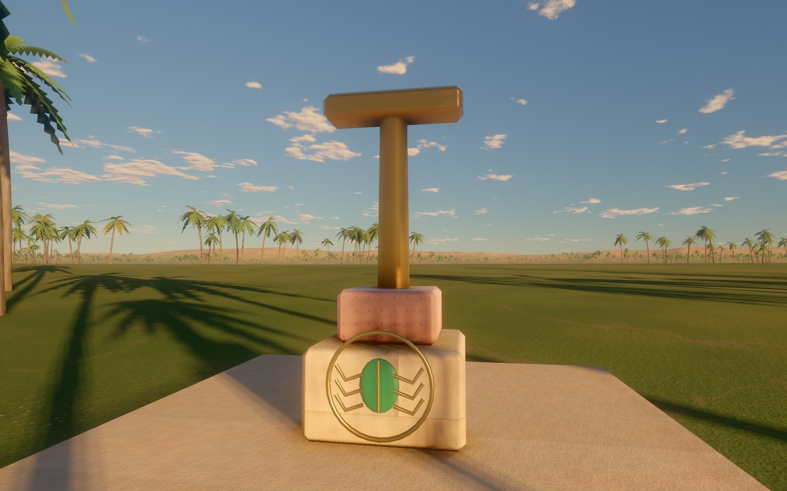
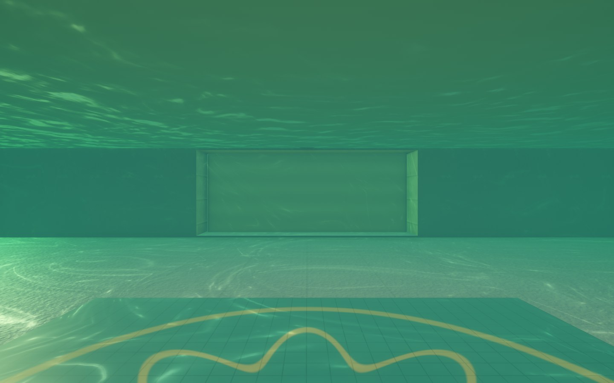
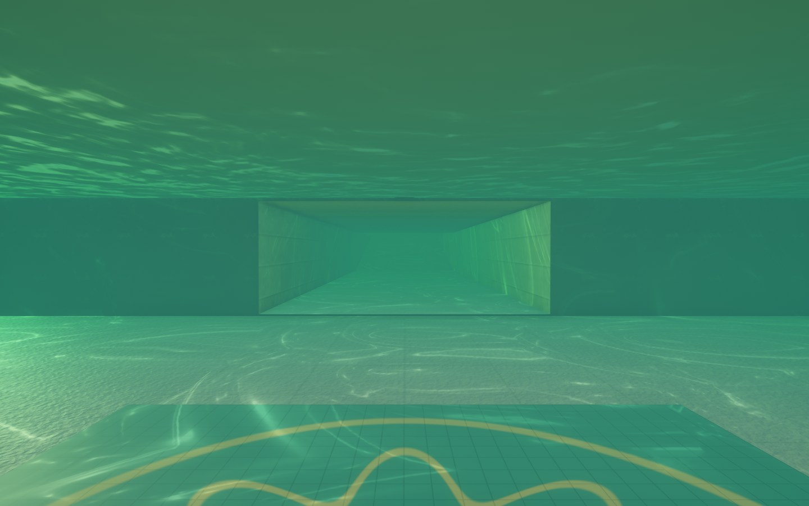
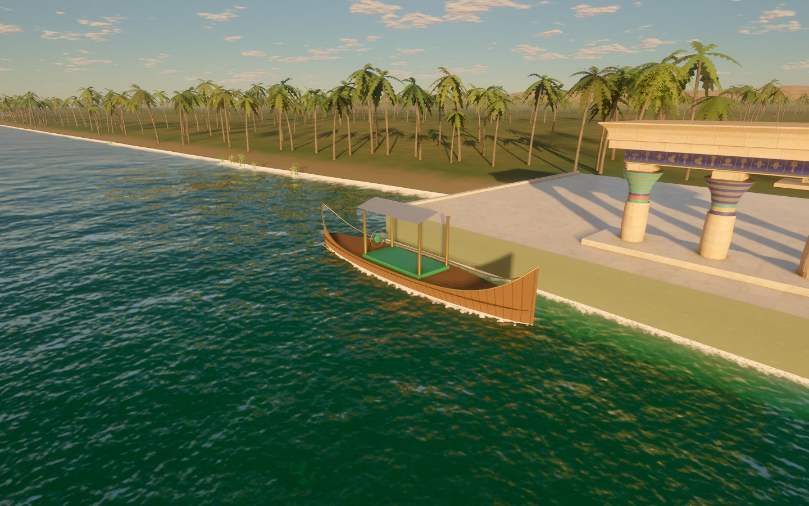
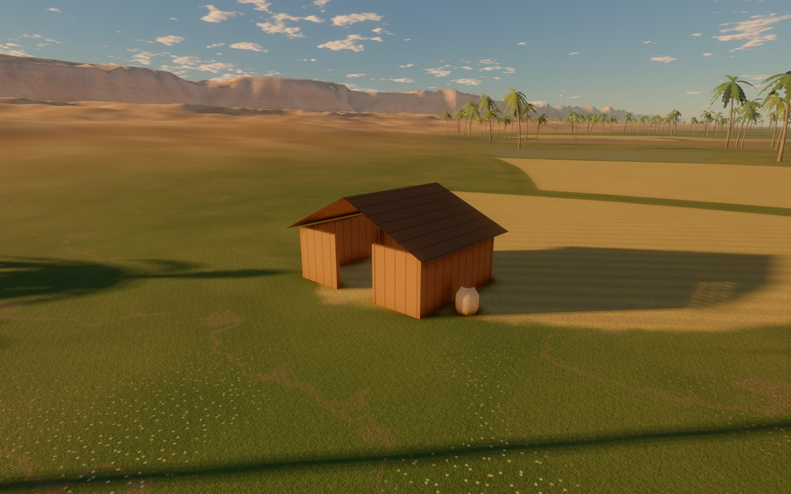
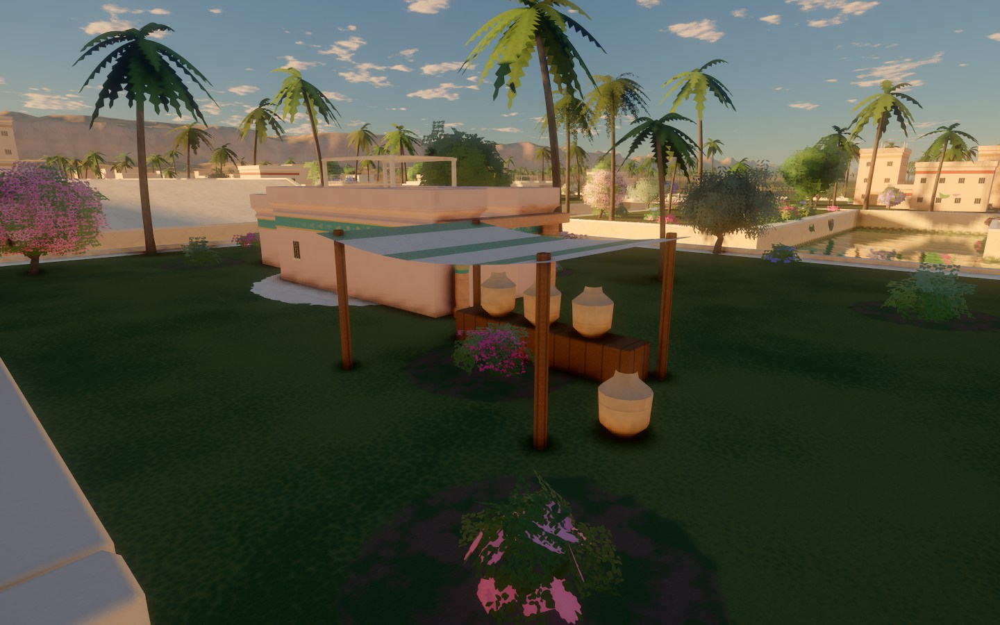
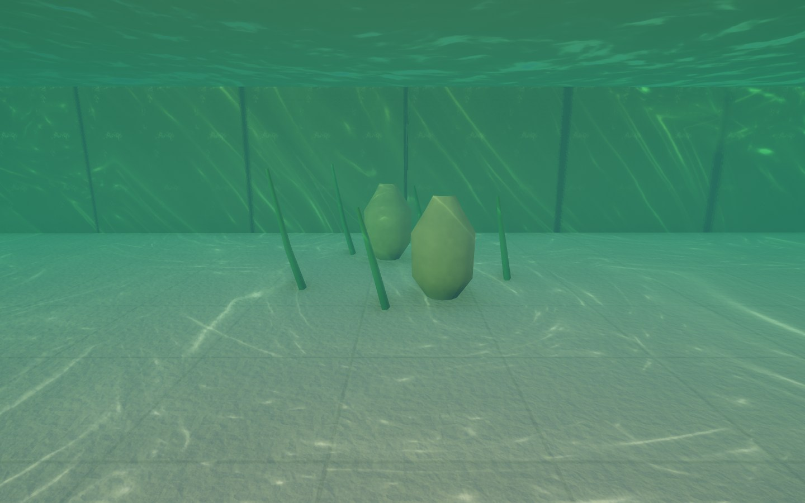
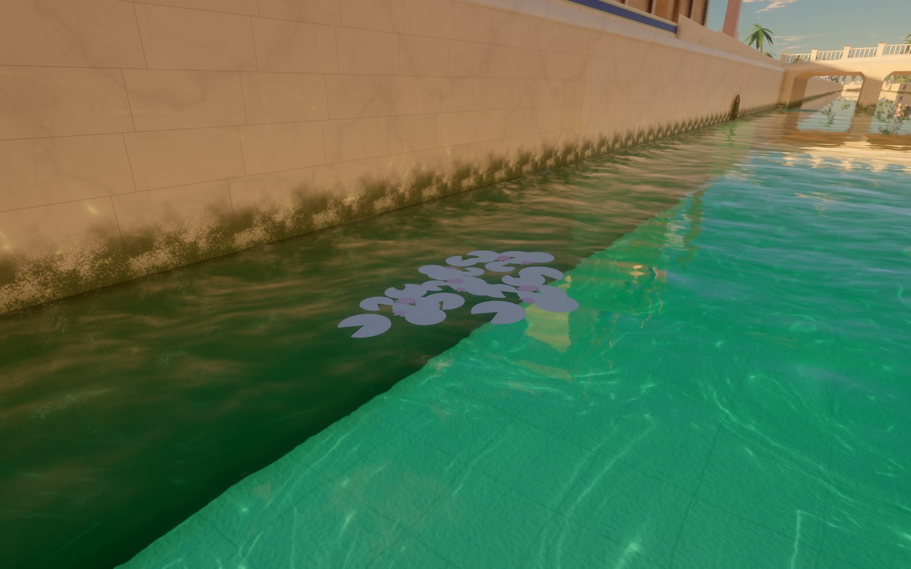

# Plan 2 — v0.7.0

Captures WebGPU Chromium 157, Mac M1, export JPEG sans retouche. La visite reste procédurale et autonome : ces images sont des preuves de rendu, jamais chargées par `index.html`.

## Vérifications

- `check:plan` : 41 607 points terre/eau, 166 surfaces, 68 variantes de maillages finis ; aller-retour de la crypte et limites existantes conservés. Les deux montants sont testés à x=119.9/120.3/120.7, z=32.2/39.8 : petits pas, recul et absence de soulèvement, porte ouverte et fermée. Les chevauchements sont récupérés vers une position admissible ; la dalle fermée bloque l’entrée.
- `check:mechanism` : proximité et orientation, séquence unique, pause, fondu, retour exact des cinq coordonnées de caméra, séquence passée, porte maintenue ouverte, état fermé dans un nouveau contexte.
- Contrôle dans le monde complet : `jambs` des trois JSON utilise les collisions réelles avec tous les bâtiments chargés ; les quatre cas de petits déplacements réussissent. La séquence filmée termine avec `open:1`, `returnedExactly:true`, `phase:0`.
- Interaction réelle dans le navigateur : bouton Actionner → Passer → retour devant le levier basculé, disparition de l’action ; relance → Actionner de nouveau. `ui-return.jpg` conserve cette observation. Pas d’évaluation subjective de l’audition ou du volume du son dans cette session.
- Rendu des trois qualités, six vues extérieures, quatre niveaux sous-marins, nouveautés et trois classes de poissons : aucun message d’erreur WebGPU remonté.
- `check:ambiance` et `check:bundle` passent ; fichier musique identique à la version précédente. Livrable : **118 351 octets**, **100 173 octets gzip** ; icône Apple facultative séparée comme auparavant.
- Accueil du fichier de production : absence des mentions L/I ; raccourcis L et I vérifiés actifs dans l’interface. `home.jpg` montre l’accueil après masquage des statistiques.

## Contenu et coût

12 bancs, 384/288/192 poissons selon la qualité, de trois classes de taille ; 18 mosaïques et 118 nouvelles petites compositions de fond. 5 cabanes, 3 tentes, 4 marchés/voiles, 9 panneaux de faïence, 4 incrustations, 8 bouquets de lotus, une grande barque et 3 petites. Une seule porte et une seule poignée animées ; les décors sont statiques, partagés et masqués à distance. Le son est ponctuel, son contexte est fermé après usage ; la musique d’origine est inchangée.

À 1440 × 900 en Medium, relevés courts : barque 12,58 ms GPU, fond de canal 12,78 ms, vue proche de mosaïque 14,88 ms. En High à cette résolution, la vue de mosaïque atteint 17,69 ms ; la résolution dynamique de la visite normale reste donc utile. Low est plafonné à 1214 × 758. Ces relevés ne sont pas un benchmark prolongé à 60 i/s ni un essai sur iPhone physique. Le scintillement antérieur de la végétation n’est pas traité par ce plan.

## Essais restant à Damien

Liste dans `PLANS.md` : deux montants sur ses appareils ; bouton tactile, son et mode muet ; séquence/retour/saut/remise à zéro ; tailles des poissons ; découvertes du décor et fluidité. La validation des tests automatiques ne remplace pas ces essais.

Reproduction : `npm run build:dev`, serveur `python3 source/tools/qa-server.py`, un seul onglet `dev.html?auto&lv=1&w=1440&h=900&qa=plan2-medium&smoke&secrets&plan2`. `lv=0` High, `lv=2` Low. Résultats sous `/tmp/hapikara-qa/plan2-medium/`. Fermer le test et arrêter le serveur après usage. `dev.html?lv=1&fps=30&lever` place uniquement le test de développement près du levier ; cet accès n’existe pas dans le livrable.
