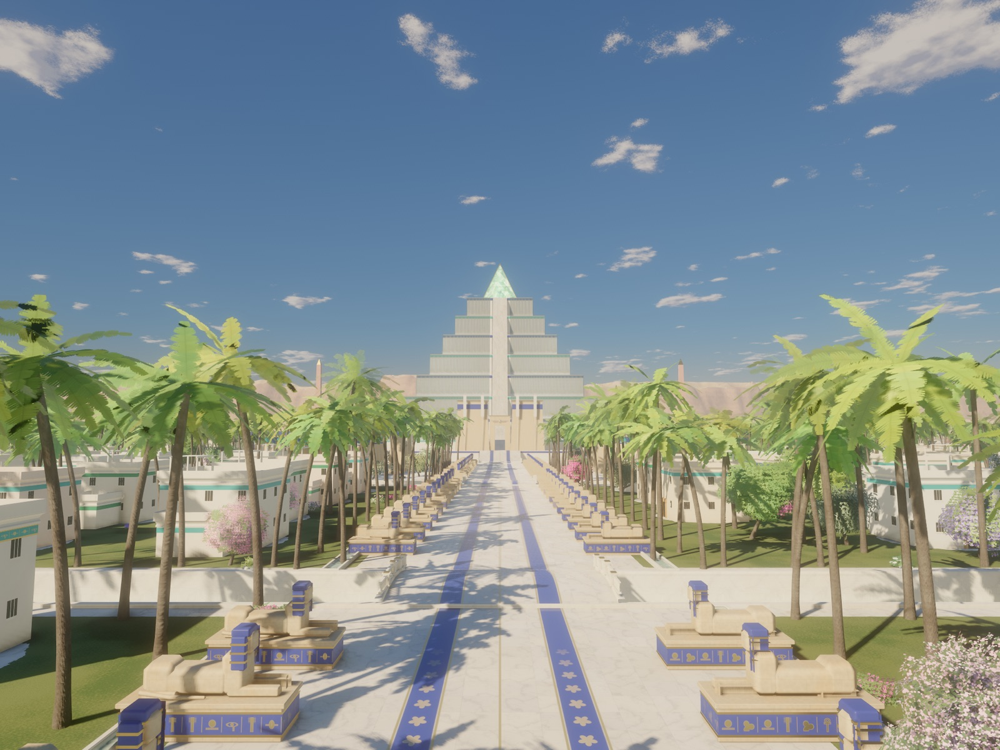
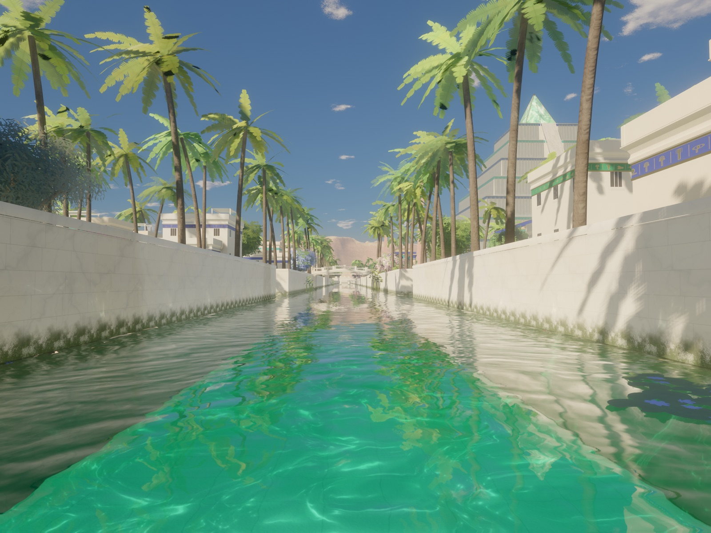
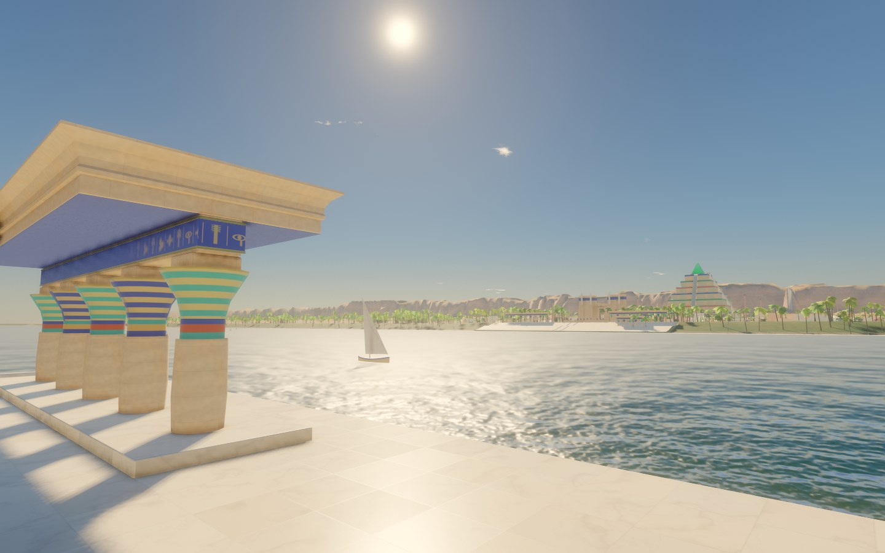

# Hapikara

**Une cité égyptienne imaginaire entre le Nil et le désert, à survoler dans le navigateur.**

Pierre dorée, pierres précieuses et eau vert-jade qui ruisselle de partout, depuis une pyramide couronnée d'émeraude jusqu'au Nil. Tout est généré par le code à l'ouverture de la page (WebGPU, sans image, modèle 3D, son ni bibliothèque), dans un seul fichier HTML.



| | |
|---|---|
|  |  |


## Mécanisme, traversée et découvertes — v0.7.0 / Plan 2

Les deux montants de l’entrée immergée permettent maintenant de se dégager même si la caméra les chevauche légèrement. La porte commence fermée. Un levier au scarabée, près du débarcadère sur la rive opposée, affiche **Actionner** à proximité : bascule, claquement/frottement synthétiques, fondu montrant l’ouverture et retour à la position/orientation exactes. La séquence peut être passée ; la porte reste ouverte pendant la visite et se réinitialise à la suivante. La musique d’origine est conservée.

Douze bancs de petits, moyens et grands poissons (384/288/192 individus selon la qualité), taille maximale réduite. Dix-huit mosaïques et 118 nouvelles compositions ponctuent les canaux. Cinq cabanes, trois tentes, quatre marchés avec voiles fixes, neuf panneaux de faïence, huit bouquets de lotus, quatre incrustations, une grande barque cérémonielle et trois petites apportent des découvertes statiques. Le scarabée revient en quelques lieux ; une gravure **DAM** se cache près d’un canal.

L’accueil n’annonce plus `L` et `I`, qui restent actifs pour les essais sur ordinateur. Les réglages d’eau, de lumière et l’intérieur sont conservés. La VR et d’autres clins d’œil restent reportés. [Captures, mesures et limites](.github/screenshots/iteration8/README.md) ; essais utilisateur à valider dans `PLANS.md`.

## Chambre funéraire et poissons visibles — v0.6.0 (historique)

Le passage possède des limites physiques indépendantes du sol extérieur : longer ses parois ne doit plus remonter la caméra sur la pyramide. Les braseros sont fixés aux murs. La chambre suit la référence artistique validée : sarcophage fermé anthropomorphe, masque et coiffe vert/or, bras croisés sculptés, coffres, pièces, coupes, vases canopes et panneaux de pseudo-hiéroglyphes.

Un véritable conduit de section 1,4 × 0,96 m est soustrait des triangles de la pyramide à la construction, orienté vers le soleil. La petite ouverture extérieure reste discrète et infranchissable. Depuis la chambre, on voit le ciel procédural au bout de ce conduit ; la cité entière n’est pas redessinée. Le faisceau dans la poussière est un renfort analytique, pas une simulation complète de transport lumineux. Le reste de la cité conserve sa géométrie.

Dix bancs plus proches des quais et moins profonds remplacent les quatre bancs éloignés : 320/240/160 poissons selon la qualité, plus grands et plus clairs. Le curseur `L` permet toujours de les réduire ou de les masquer.

[Captures et vérifications du Plan 1](.github/screenshots/iteration7/README.md). Les contrôles automatisés ne remplacent pas les essais utilisateur sur téléphone : voir `PLANS.md`.

## Passage secret et vie sous-marine — v0.5.0 (historique)

Un passage sous l’eau, dans le canal à l’est de l’acropole, mène à une galerie ascendante puis à la chambre de la pyramide : sarcophage vide, braseros et rayon solaire passant par une ouverture trop petite pour la caméra. Plan des murs et collisions sont communs ; la sortie impose de replonger. À l’intérieur, la cité extérieure et son miroir ne sont plus dessinés.

Quatre bancs de poissons parcourent le Nil : 240/160/80 individus selon les trois qualités, trois silhouettes, deux niveaux de détail et une animation GPU sans simulation individuelle. Dans `L`, leur densité peut être réduite jusqu’à zéro. Quatre ensembles de trésors ponctuent les hauts-fonds ; des mosaïques à lotus apparaissent dans les canaux.

Grain de pierre à **1,25** ; relief renforcé supprimé. L’installation sur l’écran d’accueil bénéficie d’une icône et de marges adaptées à l’encoche. Toute la scène reste dans le HTML ; seul le PNG facultatif de l’icône d’installation est séparé. Aucun mode hors connexion n’est ajouté.

[Captures et vérifications](.github/screenshots/iteration6/README.md).

## Matières, pyramide et découvertes — v0.4.0 (historique)

Soleil de fin de journée à **12°** par défaut. La pyramide conserve sa silhouette à degrés, avec des corniches sculptées, de petits pilastres et des panneaux vert malachite/or à la place des larges bandes alternées bleu-rouge-vert. Le grain des pierres et les épaules des joints sont accentués de près et filtrés à distance.

Cette version introduisait le grain modéré et un relief renforcé optionnel (retiré en v0.5.0). Le niveau sous-marin « rayons » et leur intensité maximale sont les valeurs par défaut ; la densité de l’eau reste à 0,085. Douze ensembles statiques de jarres, pierres gravées et fragments de colonne ponctuent les fonds des canaux.

Quatre destinations extérieures : un sanctuaire du désert à l’ouest, un campement près de la cité, un mémorial près de l’oasis de la cascade et un abri sur la rive du Nil. L’implantation recherche un terrain sec assez plat ; les pierres et piliers ont des collisions, les voiles des abris restent décoratives.

[Captures et mesures de cette version](.github/screenshots/iteration5/README.md). Sur la vue de mur proche à résolution fixe en Medium, les relevés courts passent de 12,38 ms GPU sans grain à 13,13 ms avec le grain par défaut, puis 14,12 ms avec le relief renforcé. Ces mesures ne remplacent pas un benchmark de fluidité sur chaque appareil.

## Accueil et atelier d’ambiance

L’accueil laisse voir l’eau et ses reflets : titre, entrée et trois qualités, sans image intégrée ni plan. **Sanctuaire voilé** est l’ambiance par défaut. Sur ordinateur, **`L`** ouvre les réglages de lumière et d’eau ; **`I`** affiche les statistiques. Aucun bouton d’outils n’encombre le téléphone. Les essais reviennent aux valeurs par défaut à chaque ouverture ; copier/importer permet de conserver volontairement des valeurs. Appliquer la position du soleil recharge la scène ; les changements de ciel et de lumière recalculent aussi l’environnement des reflets.

Les canaux, le Nil et l’oasis peuvent être explorés sous l’eau, à vitesse réduite. Le panneau `L` propose quatre niveaux : simple (teinte et visibilité), fonds (pierres et amphores), caustiques, rayons. Ces effets sont des approximations légères ; les vasques et bassins hauts restent peu profonds. Quelques fontaines supplémentaires ponctuent les esplanades.

Les palmes pleines et dentelées évitent la découpe transparente. Les transitions de détail des végétaux utilisent maintenant un motif fixe dans le monde. **Le scintillement proche reste présent** : le contrôle A/B n’a pas établi de gain sur cette vue. Des hiéroglyphes décorent les pylônes et obélisques.

## Essayer

En ligne : **https://daamhaam.github.io/hapikara/** — ou ouvrir `index.html` dans Chrome ou Edge (WebGPU). Entrée pour entrer, souris pour regarder, les flèches (haut/bas : avancer/reculer, gauche/droite : déplacement latéral) ou `W` `A` `S` `D` pour voler, `Q` / `E` pour descendre et monter, `Maj` maintenue pour accélérer (15 m/s normalement, 200 m/s accéléré, avant réglage par molette), `1` à `6` pour les points de vue, `Échap` pour le menu (niveau de détail). Sur écran tactile : un doigt pour avancer et tourner, deux doigts pour accélérer. Les commandes suivent les axes de l’écran en portrait et paysage.

> Les mesures ci-dessous concernent la livraison historique v0.2.0. Les captures et contrôles de v0.3.0 sont conservés dans [iteration4](.github/screenshots/iteration4/). La VR reste une étape séparée.

## Itération 2 — livraison du 22 novembre 2026

Les canaux forment désormais des coudes et des redans, avec des tronçons interrompus, deux lagunes et un îlot. Quatre quartiers montent à 16 ou 22 m, avec des esplanades, des escaliers et trois ensembles de temples. La majeure partie de l'eau conserve sa hauteur et sa matière ; les biefs hauts, gargouilles de lion et vasques débordent vers le réseau bas. Une cascade relie la falaise à l'oasis.

Vingt familles de villas proposent un à trois niveaux, des ailes en L ou en U, des cours, portiques, jarres et terrasses. Des greniers ronds et des chapelles complètent les quartiers. La cité ne conserve que **132 palmiers**, contre 5 058 hors les murs ; ses jardins privilégient les autres arbres et les massifs bas. La pyramide devient dorée, avec quatre escaliers, des frises lapis/cornaline/malachite et deux kiosques arrière. La réfraction du pyramidion utilise sa géométrie carrée réelle ; le halo rose et les émissions héritées du cristal d'Atlantis sont supprimés.




### Vérifications

- Géométrie et collisions : 41 607 points du plan, 166 surfaces réellement maillées et 33 générateurs/variantes vérifiés ; biefs, terrasses, escaliers et ponts concordent.
- Survol : vitesse maximale **67,5 m/s**, lacet maximal **39,7°/s**, marge minimale **1,2 m** au-dessus du sol ou de l'eau (hors bâtiments, selon `__path()`).
- WebGPU matériel : **Apple / Metal 3**, Chrome natif, 1440 × 900. Économiseur d'énergie désactivé temporairement avec autorisation, puis rétabli. Les relevés à 30 i/s avec cet économiseur ne sont pas des mesures de capacité du rendu.
- Medium, survol de 60 s sans lecture GPU pendant les images : **60,0 i/s**, image moyenne **16,67 ms**, p99 **18,00 ms**, maximum **41,50 ms**. Le critère strict « aucune image au-delà de 33 ms » n'est donc **pas validé de manière reproductible**, malgré d'autres essais entre 23 et 26 ms au maximum. Origine du pic isolé non établie ; aucun blocage principal de plus de 50 ms détecté. [Rapport final](.github/screenshots/review/medium.json).
- Avec les chronomètres GPU actifs : **11,32 ms GPU** en moyenne, p99 **15,99 ms**, maximum **17,37 ms** ; image moyenne 16,67 ms, p99 17,90 ms, maximum 34,80 ms. Le [rapport instrumenté](.github/screenshots/review/medium-with-timings.json) est conservé séparément. Les temps par vue sont des relevés de captures, pas des moyennes sur 60 s. High et Low : [mesures High](.github/screenshots/review/high.json), [mesures Low](.github/screenshots/review/low.json). Ces contrôles sur le Mac ne remplacent pas un test sur iPhone 17 Pro.
- Stabilité : `__flicker()` exécuté dans les trois niveaux. Sur une vue proche, ancienne/nouvelle version des palmes à scène et lumière identiques : variation verte moyenne **0,565 → 0,496**, pixels dépassant 6 niveaux **1,89 % → 1,54 %**, soit environ **19 % de moins**. C'est une réduction, pas une élimination du scintillement. [Contrôle avec les anciennes palmes](.github/screenshots/review/palm-control.json). Les [paires consécutives](.github/screenshots/review/) complètent les mesures ; elles ne prouvent pas l'absence totale de scintillement.

### Critique indépendante et limites connues

**La cible AAA de la bible artistique n'est pas validée.** Après trois passes, le critique confirme une meilleure lisibilité du plan, des monuments, des canaux et du soleil de P6, une palette moins jaune et davantage de variété. Il maintient un défaut critique d'aspect maquette : volumes simples, grandes parois uniformes, jardins encore trop proches d'un lotissement.

Défauts majeurs restants : palmes en rubans crantés et arbres secondaires schématiques ; émeraude trop uniforme malgré les intersections corrigées et les plans internes ; nappes d'eau encore trop proches de voiles ; matériaux précieux insuffisamment distincts. Les tentatives ont porté sur les variantes de volumes et leur implantation, les massifs et treilles, la palette et la brume, la géométrie/réfraction/inclusions du cristal, ainsi que les raccords, la transparence et l'écume des chutes. Le microdétail botanique et la matérialité demandent encore une reprise dédiée ; aucune validation visuelle artificielle n'est annoncée.

La dernière correction de l'oasis supprime la ligne dans le ciel et les palmiers suspendus ; la cascade est identifiable du sommet au bassin, mais reste trop rectangulaire. Le [rapport structuré du critique](.github/screenshots/review/critique.json) conserve ces réserves. Le chemin hydraulique complet du sommet au Nil n'est pas encore lisible partout.

## Démarche

Le projet suit la méthode d'[Atlantis](https://github.com/Noniv/atlantis) de Maksymilian Dendura :
- une bible artistique ([`artstyle.md`](artstyle.md)) ;
- des images de référence faites avec ChatGPT ([`concept-art/`](concept-art), prompts dans [`PROMPTS_CHATGPT.md`](PROMPTS_CHATGPT.md)) ;
- un cahier des charges pour Claude Code ([`prompt.txt`](prompt.txt)).

Le moteur de rendu d'Atlantis sert de base ; tout le monde (plan, architecture, végétation, matériaux, eau, lumière) est réécrit. Voir [`GUIDE.md`](GUIDE.md).

## Construire

```bash
cd source
npm install
npm run build
```

Contrôles CPU et livrable : `cd source && npm run check:plan && npm run check:ambiance && npm run check:bundle`. Le fichier minifié autonome fait environ **118 ko** (100 ko gzip), sans ressource externe de scène. Pour reproduire les nouvelles captures, lancer `python3 source/tools/qa-server.py` à la racine, puis ouvrir `http://localhost:8137/dev.html?auto&lv=1&w=1440&h=900&qa=secrets-medium&smoke&secrets` après `npm run build:dev` (`lv=0/1/2` : High/Medium/Low). Ajouter `bench` pour le parcours chronométré. Les captures de développement et les outils de mesure ne sont pas inclus dans `index.html`.

## Licence

[MIT](LICENSE). Moteur d'origine © Maksymilian Dendura (Atlantis).
