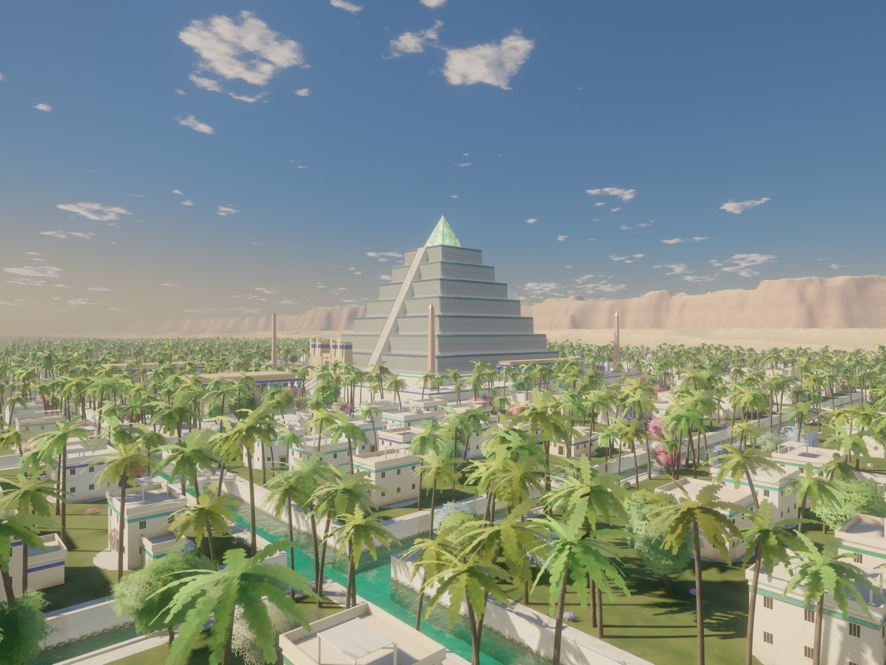
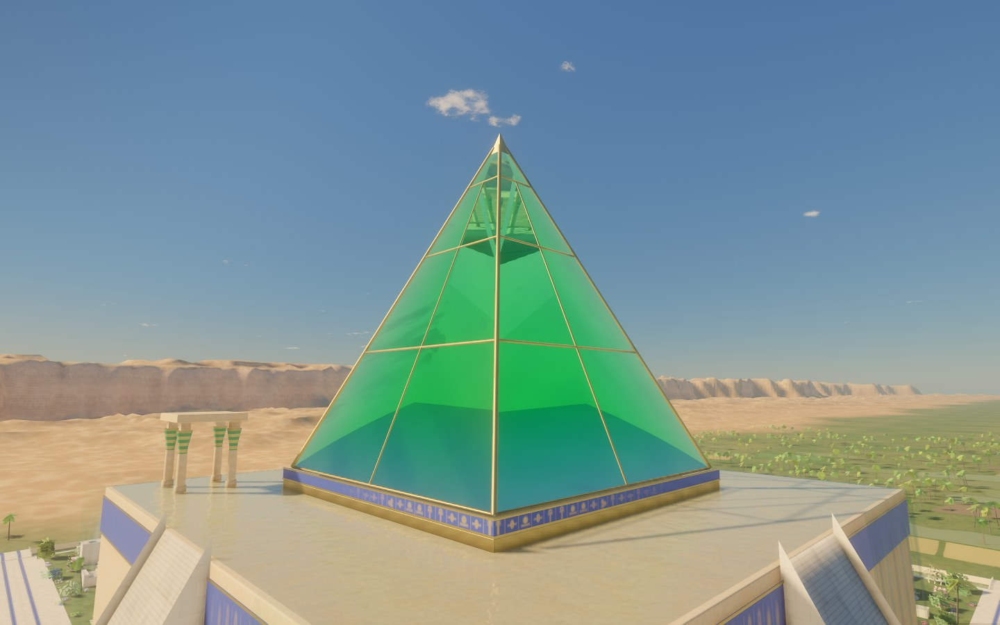

# Hapikara

**Une cité égyptienne imaginaire entre le Nil et le désert, à survoler dans le navigateur.**

Pierre dorée, pierres précieuses et eau vert-jade qui ruisselle de partout, depuis une pyramide couronnée d'émeraude jusqu'au Nil. Tout est généré par le code à l'ouverture de la page (WebGPU, sans image, modèle 3D, son ni bibliothèque), dans un seul fichier HTML.


| | |
|---|---|
|  |  |


## Atelier d'ambiance et plan de la cité

L'accueil montre le **plan de la cité**, généré à partir du vrai tracé des canaux et des terrasses : choisissez un lieu pour y commencer la visite. Le bouton **Ambiance** (touche `L`) ouvre un atelier de réglages de la lumière : soleil, ombres, couleurs, brume, ciel, eau et cristal. Il propose trois ambiances de départ, une comparaison avec l'ouverture, une sauvegarde sur l'appareil et **« Copier mes réglages »** pour transmettre les valeurs retenues. Le bouton **i/s** (touche `H`) affiche les images par seconde.

Les palmes sont désormais des feuilles pleines et dentelées, sans découpe transparente : elles ne clignotent plus. Des colonnes de hiéroglyphes sont gravées sur les pylônes et dorées sur les obélisques.

## Essayer

En ligne : **https://daamhaam.github.io/hapikara/** — ou ouvrir `index.html` dans Chrome ou Edge (WebGPU). Entrée pour entrer, souris pour regarder, `W` `A` `S` `D` pour voler, `Q` / `E` pour descendre et monter, `Maj` pour accélérer, `1` à `6` pour les points de vue, `Échap` pour le menu (niveau de détail). Sur écran tactile : un doigt pour avancer et tourner.

> 🚧 Itération 2 — v0.2.0 : canaux segmentés, lagunes et îlot, quartiers en terrasses, temples et villas variés, palmiers beaucoup moins nombreux en ville. Environ 60 i/s sont mesurées sur le Mac M1 ; les pics isolés et la cible photoréaliste restent à améliorer.

## Itération 2 — livraison du 22 novembre 2026

Les canaux forment désormais des coudes et des redans, avec des tronçons interrompus, deux lagunes et un îlot. Quatre quartiers montent à 16 ou 22 m, avec des esplanades, des escaliers et trois ensembles de temples. La majeure partie de l'eau conserve sa hauteur et sa matière ; les biefs hauts, gargouilles de lion et vasques débordent vers le réseau bas. Une cascade relie la falaise à l'oasis.

Vingt familles de villas proposent un à trois niveaux, des ailes en L ou en U, des cours, portiques, jarres et terrasses. Des greniers ronds et des chapelles complètent les quartiers. La cité ne conserve que **132 palmiers**, contre 5 058 hors les murs ; ses jardins privilégient les autres arbres et les massifs bas. La pyramide devient dorée, avec quatre escaliers, des frises lapis/cornaline/malachite et deux kiosques arrière. La réfraction du pyramidion utilise sa géométrie carrée réelle ; le halo rose et les émissions héritées du cristal d'Atlantis sont supprimés.




### Vérifications

- Géométrie et collisions : 41 607 points du plan, 166 surfaces réellement maillées et 33 générateurs/variantes vérifiés ; biefs, terrasses, escaliers et ponts concordent.
- Survol : vitesse maximale **67,5 m/s**, lacet maximal **39,7°/s**, marge minimale **1,2 m** au-dessus du sol ou de l'eau (hors bâtiments, selon `__path()`).
- WebGPU matériel : **Apple / Metal 3**, Chrome natif, 1440 × 900. Économiseur d'énergie désactivé temporairement avec autorisation, puis rétabli. Les relevés à 30 i/s avec cet économiseur ne sont pas des mesures de capacité du rendu.
- Medium, survol de 60 s sans lecture GPU pendant les images : **60,0 i/s**, image moyenne **16,67 ms**, p99 **18,00 ms**, maximum **41,50 ms**. Le critère strict « aucune image au-delà de 33 ms » n'est donc **pas validé de manière reproductible**, malgré d'autres essais entre 23 et 26 ms au maximum. Origine du pic isolé non établie ; aucun blocage principal de plus de 50 ms détecté. [Rapport final](.github/screenshots/review/medium.json).
- Avec les chronomètres GPU actifs : **11,32 ms GPU** en moyenne, p99 **15,99 ms**, maximum **17,37 ms** ; image moyenne 16,67 ms, p99 17,90 ms, maximum 34,80 ms. Le [rapport instrumenté](.github/screenshots/review/medium-with-timings.json) est conservé séparément. Les temps par vue sont des relevés de captures, pas des moyennes sur 60 s. High et Low : [mesures High](.github/screenshots/review/high.json), [mesures Low](.github/screenshots/review/low.json). Ces contrôles sur le Mac ne remplacent pas un test sur iPhone 17 Pro.
- Stabilité : `__flicker()` exécuté dans les trois niveaux. Sur une vue proche, ancienne/nouvelle version des palmes à scène et lumière identiques : variation verte moyenne **0,565 → 0,496**, pixels dépassant 6 niveaux **1,89 % → 1,54 %**, soit environ **19 % de moins**. C'est une réduction, pas une élimination du scintillement. [Contrôle avec les anciennes palmes](.github/screenshots/review/palm-control.json). Les [paires consécutives](.github/screenshots/review/) complètent les mesures ; elles ne prouvent pas l'absence totale de scintillement.

### Critique indépendante et limites connues

**La cible AAA de la bible artistique n'est pas validée.** Après trois passes, le critique confirme une meilleure lisibilité du plan, des monuments, des canaux et du soleil de P6, une palette moins jaune et davantage de variété. Il maintient un défaut critique d'aspect maquette : volumes simples, grandes parois uniformes, jardins encore trop proches d'un lotissement.

Défauts majeurs restants : palmes en rubans crantés et arbres secondaires schématiques ; émeraude trop uniforme malgré les intersections corrigées et les plans internes ; nappes d'eau encore trop proches de voiles ; matériaux précieux insuffisamment distincts. Les tentatives ont porté sur les variantes de volumes et leur implantation, les massifs et treilles, la palette et la brume, la géométrie/réfraction/inclusions du cristal, ainsi que les raccords, la transparence et l'écume des chutes. Le microdétail botanique et la matérialité demandent encore une reprise dédiée ; aucune validation visuelle artificielle n'est annoncée.

La dernière correction de l'oasis supprime la ligne dans le ciel et les palmiers suspendus ; la cascade est identifiable du sommet au bassin, mais reste trop rectangulaire. Le [rapport structuré du critique](.github/screenshots/review/critique.json) conserve ces réserves. Le chemin hydraulique complet du sommet au Nil n'est pas encore lisible partout.

## Démarche

Le projet suit la méthode d'[Atlantis](https://github.com/Noniv/atlantis) de Maksymilian Dendura :
- une bible artistique ([`artstyle.md`](artstyle.md)) ;
- des images de référence faites avec ChatGPT ([`concept-art/`](concept-art), prompts dans [`PROMPTS_CHATGPT.md`](PROMPTS_CHATGPT.md)) ;
- un cahier des charges pour Claude Code ([`prompt.txt`](prompt.txt)).

Le moteur de rendu d'Atlantis sert de base ; tout le monde (plan, architecture, végétation, matériaux, eau, lumière) est réécrit. Voir [`GUIDE.md`](GUIDE.md).

## Construire

```bash
cd source
npm install
npm run build
```

Contrôles CPU et livrable : `cd source && npm run check:plan && npm run check:bundle`. Le fichier minifié autonome pèse **94 482 octets** (80 628 octets gzip). Pour reproduire les captures et le benchmark, lancer `python3 source/tools/qa-server.py` à la racine, puis ouvrir dans Chrome `http://localhost:8137/dev.html?auto&lv=1&w=1440&h=900&qa=release-medium&bench&nots` après `npm run build:dev`. Les captures de développement et les outils de mesure ne sont pas inclus dans `index.html`.

## Licence

[MIT](LICENSE). Moteur d'origine © Maksymilian Dendura (Atlantis).
