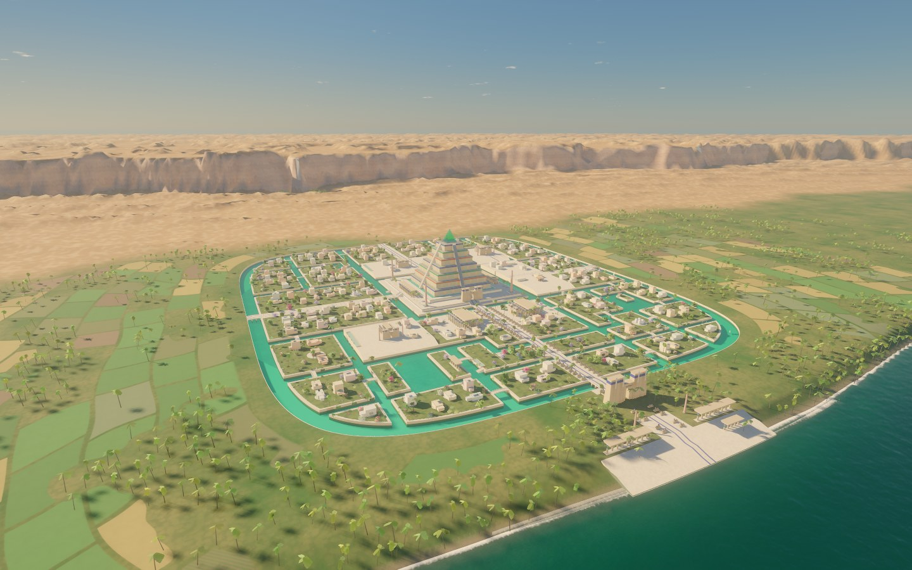

# Hapikara

**Une cité égyptienne imaginaire entre le Nil et le désert, à survoler dans le navigateur.**

Pierre dorée, pierres précieuses et eau vert-jade qui ruisselle de partout, depuis une pyramide couronnée d'émeraude jusqu'au Nil. Tout est généré par le code à l'ouverture de la page (WebGPU, sans image, modèle 3D, son ni bibliothèque), dans un seul fichier HTML.


| | |
|---|---|
|  |  |



## Essayer

Ouvrir `index.html` dans Chrome ou Edge (WebGPU). Entrée pour entrer, souris pour regarder, `W` `A` `S` `D` pour voler, `Q` / `E` pour descendre et monter, `Maj` pour accélérer, `1` à `6` pour les points de vue, `Échap` pour le menu (niveau de détail). Sur écran tactile : un doigt pour avancer et tourner.

> 🚧 Première version : la ville, l'eau, la pyramide et la végétation sont en place ; les détails et le réalisme s'affinent.

## Démarche

Le projet suit la méthode d'[Atlantis](https://github.com/Noniv/atlantis) de Maksymilian Dendura :
- une bible artistique ([`artstyle.md`](artstyle.md)) ;
- des images de référence faites avec ChatGPT ([`concept-art/`](concept-art), prompts dans [`PROMPTS_CHATGPT.md`](PROMPTS_CHATGPT.md)) ;
- un cahier des charges pour Claude Code ([`prompt.txt`](prompt.txt)).

Le moteur de rendu d'Atlantis sert de base ; tout le monde (plan, architecture, végétation, matériaux, eau, lumière) est réécrit. Voir [`GUIDE.md`](GUIDE.md).

## Construire

```bash
cd source
npm install
npm run build
```

## Licence

[MIT](LICENSE). Moteur d'origine © Maksymilian Dendura (Atlantis).
